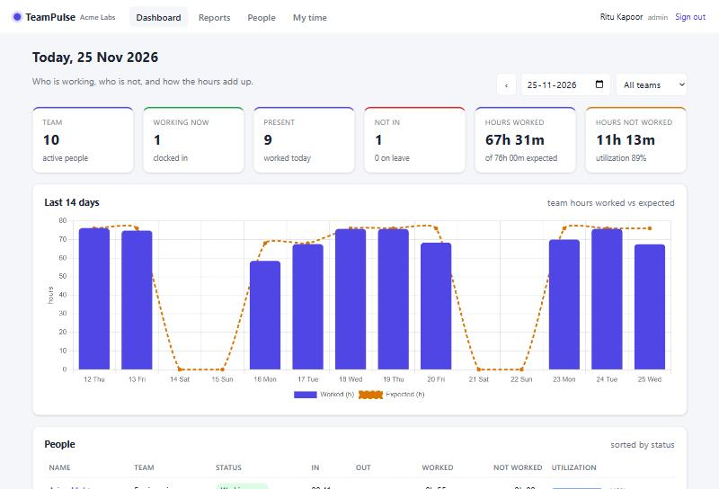
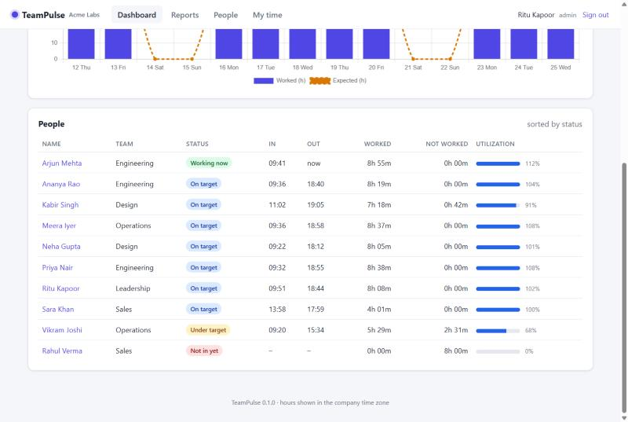
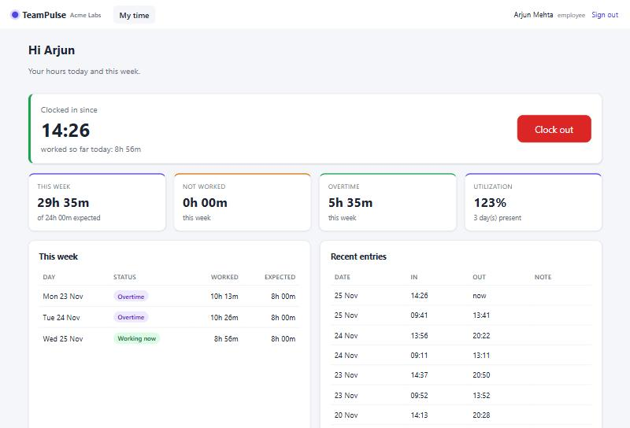
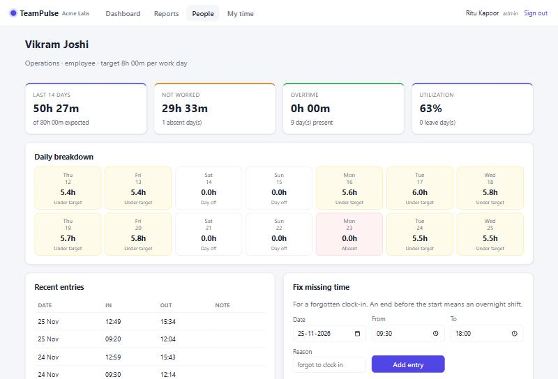
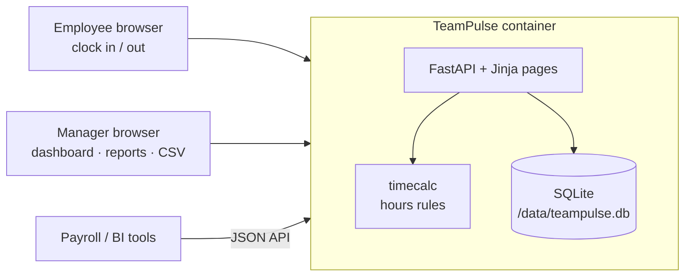

# TeamPulse

[](https://github.com/Subhamsharm25/teampulse/actions/workflows/ci.yml)
[](LICENSE)

**A daily hours and attendance dashboard for small startup teams.** People clock in and out from any
browser. Founders and managers see, at a glance, who is working right now, who has not come in, how many
hours each person has worked, how many expected hours were *not* worked, and everyone's utilization,
today and over any period.

It runs as a single container with one SQLite file, so a 5- to 50-person team can host it on any small
VM, a Raspberry Pi or Kubernetes, without paying per seat.



## The problem

Small teams usually track time in a shared spreadsheet or not at all. The questions founders ask every
day are simple, yet hard to answer from a spreadsheet:

* Who is working right now, and who has not shown up?
* How many hours did each person actually work today and this week, against what we expect?
* How many expected hours were lost: absences, short days?
* Who is consistently overworking, a burnout risk, or consistently under target?
* What do I hand to payroll or to a client at the end of the month?

Enterprise HR suites answer these but cost per seat and take weeks to set up. TeamPulse does the core of
it in one small app.

## Features

| For | What they get |
|---|---|
| **Everyone** | One-click **Clock in / Clock out** (works on phones), today's hours, this week's hours vs target, overtime, recent entries |
| **Managers** | **Live dashboard**: team size, working now, present, not in or absent, hours worked, **hours not worked**, utilization; per-person status, first in, last out; 14-day trend chart; any past day; filter by team |
| | **Person view**: 14-day calendar (absent, under target, on target, overtime, leave, holiday), corrections for forgotten clock-ins (overnight shifts supported), leave and sick days |
| | **Reports** for any date range: worked, expected, not worked, overtime, utilization, days present, absent and on leave per person; **CSV export** for payroll |
| **Admins** | Add people with their own daily target (8 h full-time, 4 h part-time, …), roles, deactivate leavers, company holidays |
| **Developers** | JSON API (`/api/v1/dashboard`, `/api/v1/trend`, `/api/v1/me`), OpenAPI docs at `/api/docs`, `/healthz` |

| People | Employee view |
|---|---|
|  |  |



## How hours are counted

All rules live in one pure module ([`timecalc.py`](src/teampulse/timecalc.py)), and every rule has a unit test.

* A day is a calendar day in the **company time zone**. A session that crosses midnight is split across
  both days; an open session counts up to *now*. Daylight-saving days are 23 or 25 hours long, computed
  in UTC.
* **Expected hours** = the person's daily target on work days. Leave days and company holidays expect 0.
* **Not worked** = max(expected − worked, 0). **Overtime** = max(worked − expected, 0). Work on a weekend,
  holiday or leave day counts entirely as overtime ("extra day").
* **Utilization** = worked ÷ expected.
* Day status: *working now*, *not in yet* (today), *absent* (past work day with 0 h), *under target*
  (< 75 % of target, configurable), *on target*, *overtime* (> target + 1 h), *leave*, *holiday*, *day off*.



## Security

* Passwords hashed with **scrypt**; signed, HTTP-only, SameSite session cookies (`Secure` behind HTTPS).
* **CSRF tokens** on every form; **login rate limiting** (5 failures per email per 15 minutes).
* Role checks on every route: employees see only their own time. Error pages return real status codes.
* Container runs as a non-root user with a read-only root filesystem on Kubernetes; image scanned by Trivy in CI.
* At most one open session per person (enforced by a database index); manual entries cannot overlap,
  exceed 16 hours, or end in the future.

## Run it

**Docker (recommended):**

```bash
cp .env.example .env          # set TEAMPULSE_SECRET_KEY and your company name
docker compose up -d --build
docker compose run --rm -e TEAMPULSE_ADMIN_PASSWORD='choose-a-strong-one' teampulse \
  create-admin --name "Your Name" --email you@yourstartup.com
# open http://localhost:8000
```

Want to look around first? Run `docker compose run --rm teampulse seed-demo` on an empty database. It
creates a 10-person demo startup with four weeks of history. Demo logins: `ritu@demo.teampulse.dev`
(admin), `meera@demo.teampulse.dev` (manager), `priya@demo.teampulse.dev` (employee), password
`teampulse-demo`. These are demo data only; don't seed a production database.

**Without Docker:** `pip install -e .` then `python -m teampulse seed-demo` and `python -m teampulse serve`.

**Kubernetes:** see [`deploy/kubernetes.yaml`](deploy/kubernetes.yaml): one replica (single SQLite writer),
`Recreate` strategy, PersistentVolume, probes, non-root, read-only root filesystem.

Settings (environment variables, see [`.env.example`](.env.example)): `TEAMPULSE_SECRET_KEY`,
`TEAMPULSE_COMPANY`, `TEAMPULSE_TZ` (default `Asia/Kolkata`), `TEAMPULSE_WORKDAYS` (default Mon–Fri),
`TEAMPULSE_UNDER_RATIO`, `TEAMPULSE_SECURE_COOKIES`, `TEAMPULSE_DB`.

## CI/CD

[`ci.py`](ci.py) holds every stage. [GitHub Actions](.github/workflows/ci.yml) and the
[Jenkinsfile](Jenkinsfile) only call it.

| Stage | What it proves |
|---|---|
| `lint` | ruff lint + format |
| `unit` | 34 tests: hours rules (overnight, open sessions, DST, leave, holidays, extra days, thresholds), storage rules, security (hashing, CSRF, rate limit, roles), every page and API, CSV, CLI. Coverage ≥ 90 % (currently 95 %) |
| `build` / `scan` | multi-stage non-root image; Trivy finds no fixable HIGH/CRITICAL CVEs |
| `smoke` | runs the real image, seeds data, **signs in over HTTP** and checks the dashboard, reports, people, CSV and API |
| `k8s` | deploys `deploy/kubernetes.yaml` to a k3d cluster, seeds inside the pod, repeats the HTTP checks through the Service |

```bash
pip install -e ".[dev]" && python ci.py all
```

## Limits and next steps

* SQLite suits one instance and tens of people. Larger teams would switch the storage layer
  ([`db.py`](src/teampulse/db.py)) to PostgreSQL.
* Time is self-reported by clocking in and out. There is no screen or activity monitoring, by design.
* Next: leave requests with approval, project/client tags on sessions for billable-hours reports,
  Slack reminders for people who forgot to clock out, SSO (Google Workspace / Microsoft 365).

## License

MIT © 2026 Subham Sharma
